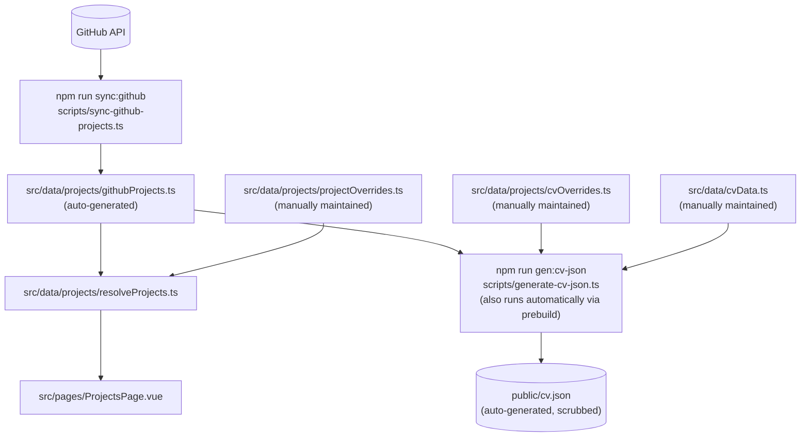

# Standalone scripts that perform special development functions

## GitHub Auth Token

`sync:github` reads `GITHUB_TOKEN` from `.env` in the project root (gitignored). Without it the script still works but is subject to GitHub's unauthenticated rate limit (60 req/hr).

**Creating a token:**

1. Go to GitHub → Settings → Developer settings → Personal access tokens → Fine-grained tokens
2. Click **Generate new token**
3. Set an expiry, select your account as the resource owner
4. Copy the token and paste it as `GITHUB_TOKEN=<token>` in `.env`

---

## CV JSON Generation Scripts

| File Name                 | `npm run` command   | Function                                                                                                                                |
| ------------------------- | ------------------- | --------------------------------------------------------------------------------------------------------------------------------------- |
| `sync-github-projects.ts` | `sync:github`       | Pulls GitHub projects into `src/data/projects/githubProjects.ts`                                                                        |
| `generate-cv-json.ts`     | `gen:cv-json`       | Generates `public/cv.json` by combining `githubProjects.ts`, `cvOverrides.ts`, and `cvData.ts`. Also runs automatically via `prebuild`. |
| `render-cv.ts`            | `render:cv`         | Navigates to `.../cv` and renders the **public, scrubbed** `public/cv.pdf` using Playwright                                             |
| `render-cv.ts`            | `render:cv:contact` | Same, but renders a **private** `cv-private.pdf` (gitignored) **with contact info** from `.env.local`                                   |

### Contact info gating (email and phone)

Contact details are **never** stored in the repo or on the deployed site. `cvData.ts`
reads them from the environment:

```ts
const env = import.meta.env as ImportMetaEnv | undefined;
email: env?.VITE_CV_EMAIL || undefined,
phone: env?.VITE_CV_PHONE || undefined,
```

When those vars are unset, `basics.email` / `basics.phone` are `undefined` and every
consumer omits them (web `/cv`, `cv.json`, `cv.pdf`, the Home "Email" button, terminal `whoami`).

Set the real values in a **gitignored `.env.local`** (see `.env.example`):

```bash
VITE_CV_EMAIL=you@example.com
VITE_CV_PHONE=00000 000000
```

| Where                                          | Contact info shown? | Why                                                                                           |
| ---------------------------------------------- | ------------------- | --------------------------------------------------------------------------------------------- |
| `npm run render:cv:contact` → `cv-private.pdf` | ✅ yes              | reads `.env.local`; output is gitignored — this is the copy you send to recruiters            |
| `npm run render:cv` → `public/cv.pdf`          | ❌ no               | forces an empty `envDir`, so `.env.local` is ignored and the committed PDF is always scrubbed |
| `gen:cv-json` → `public/cv.json`               | ❌ no               | runs under `tsx` with no Vite env, so it's always scrubbed                                    |
| Deployed site (GitHub Actions `npm run build`) | ❌ no               | CI has no `.env.local` / env vars                                                             |
| Deployed site **opted in**                     | ✅ yes              | only if `VITE_CV_EMAIL` / `VITE_CV_PHONE` are explicitly added to the deploy workflow's env   |

> ⚠️ The opt-in is "env var present at build time." Deploys go through GitHub Actions
> (no `.env.local`), so the live site is scrubbed by default. Do **not** run `npm run build`
> locally with `.env.local` present and then manually publish that `dist/` — the prerendered
> `/cv` HTML would include contact info. Always deploy via CI.

### CV JSON Pipeline



## CV Schema Generation Scripts

| File Name               | `npm run` command | Function                                                                                                                           |
| ----------------------- | ----------------- | ---------------------------------------------------------------------------------------------------------------------------------- |
| `generate-cv-schema.ts` | `gen:cv-schema`   | Pulls the `jsonresume.org` JSON Schema and generates `src/data/models/CV.ts` TypeScript CV type definition using `jsonSchemaToZod` |

## Project Audit Script

| File Name           | `npm run` command | Function                                                                                              |
| ------------------- | ----------------- | ----------------------------------------------------------------------------------------------------- |
| `audit-projects.ts` | `audit:projects`  | Prints a table showing all GitHub projects and whether they appear on the Projects page and/or the CV |

## Theme Validation Scripts

| File Name              | `npm run` command   | Function                                       |
| ---------------------- | ------------------- | ---------------------------------------------- |
| `validate-themes.ts`   | `validate:themes`   | Makes sure that the themes are set up properly |
| `validate-contrast.ts` | `validate:contrast` | Makes sure that the themes are WCAG compliant  |
